<p align="center">
  <picture>
    <source media="(prefers-color-scheme: dark)" srcset="docs/images/logo-dark.png">
    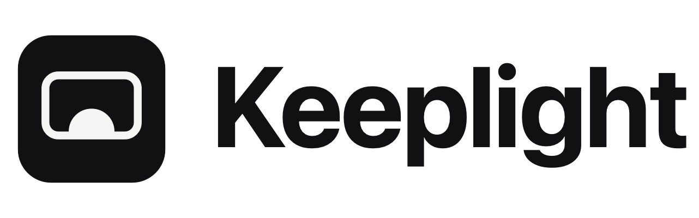
  </picture>
</p>

<p align="center">
  English | <a href="README.tr.md">Türkçe</a>
</p>

<p align="center">
  <strong>Brightness and resolution for every display on your Mac, and a way back from every change.</strong>
</p>

<p align="center">
  Keeplight is a small menu bar app, with a command-line tool, for the displays on your desk. One
  slider sets an external monitor's brightness over DDC/CI and keeps going below the monitor's own
  minimum when even that is too bright at night. Pick any resolution, HiDPI modes included. A change
  you don't keep goes back on its own after 15 seconds, so a blank screen never lasts. No network, no
  telemetry, and the undocumented macOS interfaces it relies on are listed in the app, not hidden.
</p>

<p align="center">
  <a href="https://github.com/htahaozlu/keeplight/releases/latest/download/Keeplight.dmg">
    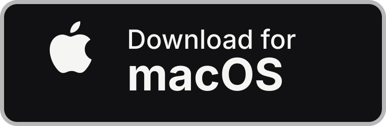
  </a>
</p>

<p align="center">
  <strong>Prefer Homebrew?</strong> <code>brew install --cask htahaozlu/keeplight/keeplight</code>
</p>

<p align="center">
  <a href="https://github.com/htahaozlu/keeplight/releases/latest"></a>
  
  
  
  <a href="LICENSE"></a>
  
</p>

<p align="center">
  <picture>
    <source media="(prefers-color-scheme: dark)" srcset="docs/images/hero-dark.svg">
    
  </picture>
</p>

## Why Keeplight

- **Darker than the monitor goes.** The lowest backlight of most monitors is far brighter than a Mac
  screen's lowest step. Keeplight's slider uses the monitor's own range down to about 19; below that
  the backlight stays at its minimum and Keeplight dims the picture itself through the display's gamma
  table, all the way to black at 0, like a Mac screen. macOS puts the table back when Keeplight quits.
- **Every risky change waits for Keep.** A new resolution, main display, mirroring or disconnect
  shows a card on every screen with fifteen red dots. <kbd>Return</kbd> keeps it; <kbd>Esc</kbd>, or
  doing nothing for 15 s (30 s if you prefer), puts the old setup back. It goes back too if the Mac
  sleeps or the display leaves first, and a change that is still waiting when Keeplight quits or
  crashes is undone, at the latest when it starts again. Picture gone completely? Hold
  <kbd>⌃⌥⌘R</kbd>.
- **One calm panel.** Every display is a tile with a capsule slider and its resolution, in the
  language of Control Center. Built-in and Apple displays go through macOS, external monitors through
  DDC/CI. No Dock icon, no sound, and the only red in the app is a countdown's dots.
- **Honest about how.** Keeplight calls 13 undocumented macOS functions (display modes, Apple
  brightness, display names, DDC/CI). They are looked up at run time, listed in Settings › About and
  by `keeplight interfaces`, and if a macOS update removes one, only the feature that needs it turns
  off. There is no networking code in the app at all, and the build fails if any shows up.
- **Accessible.** Panel and card controls carry VoiceOver labels and the Keep card speaks the time
  left; Reduce Motion, Reduce Transparency and Increase Contrast are respected.

## Features

| | |
|---|---|
| **Brightness** | Built-in and Apple displays through macOS, external monitors over DDC/CI (Apple silicon). Drag the slider, or turn on the keyboard's brightness keys: they change the monitor under the pointer and show a small level card (hold <kbd>⌥</kbd> for quarter steps, as in macOS). Built-in and Apple displays keep macOS's own keys and OSD. |
| **Below the minimum** | On a DDC monitor the bottom of the slider, the lowest 3 of the 16 key steps, keeps the backlight at its minimum and dims the picture further. The CLI stays on the monitor's own 0–100. |
| **Resolution** | Up to six recommended sizes one click away; `Show All…` lists every usable mode, HiDPI included, grouped by refresh rate (`keeplight modes --all` shows even the raw list). `Soft` marks a size that will look blurry on that panel. |
| **Keep or it goes back** | Resolution, main display, mirroring and disconnect wait on the Keep card: <kbd>Return</kbd> keeps, <kbd>Esc</kbd> or the timer (15 s or 30 s) reverts. |
| **Rescue** | Hold <kbd>⌃⌥⌘R</kbd>: Keeplight reverts what is waiting, reconnects the displays it disconnected, stops the mirrors it started and restores the last setup you kept. Hold <kbd>⇧</kbd> while it starts for a safe start that applies nothing. |
| **Arrange** | Make a display the main one, mirror it, stop mirroring, disconnect it until you log out, or click its name to see which screen is which. |
| **Undo and history** | <kbd>⌘Z</kbd> in the panel, or the receipt's `Undo`. One journal records every change, from the app and from the CLI. |
| **After sleep** | Brightness is set back after wake (on by default), with a receipt and `Undo`. |
| **Diagnostics** | `No brightness control ⓘ` says why in one line; Settings › Displays has `Check Again` and `Copy Report`; `keeplight doctor` grades every step for a bug report. |

<table>
  <tr>
    <td width="50%" valign="top">
      <picture>
        <source media="(prefers-color-scheme: dark)" srcset="docs/images/app/panel-1-display-dark.png">
        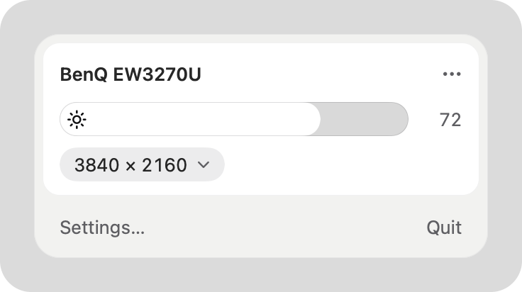
      </picture>
      <p align="center"><sub>One monitor: brightness and resolution.</sub></p>
      <picture>
        <source media="(prefers-color-scheme: dark)" srcset="docs/images/app/keep-card-dark.gif">
        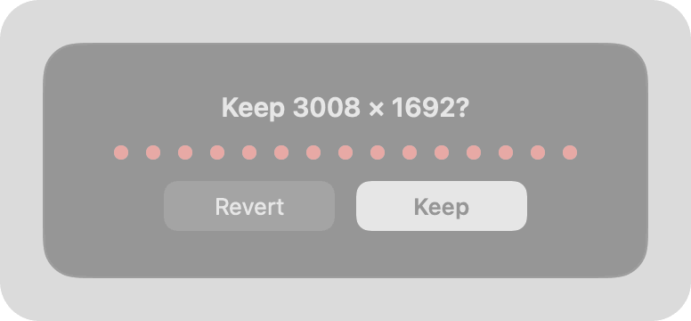
      </picture>
      <p align="center"><sub>The Keep card, 4× speed: nobody pressed Keep, so it went back.</sub></p>
      <picture>
        <source media="(prefers-color-scheme: dark)" srcset="docs/images/app/osd-dark.png">
        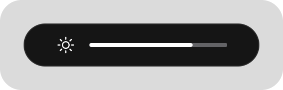
      </picture>
      <p align="center"><sub>Brightness keys on a DDC monitor.</sub></p>
    </td>
    <td width="50%" valign="top">
      <picture>
        <source media="(prefers-color-scheme: dark)" srcset="docs/images/app/panel-3-displays-dark.png">
        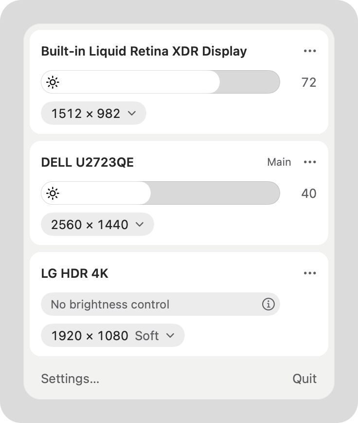
      </picture>
      <p align="center"><sub>Three displays, one of them without brightness control.</sub></p>
    </td>
  </tr>
</table>

<sub>Every screenshot here is an offscreen render of the app's real views on simulated displays
(`scripts/render.sh`); the panel is shown in its Reduce Transparency form.</sub>

## Install

### Direct download (DMG)

1. Download [**Keeplight.dmg**](https://github.com/htahaozlu/keeplight/releases/latest/download/Keeplight.dmg)
   from the latest release (universal: Apple silicon and Intel; macOS 14 Sonoma or later).
2. Open it and drag **Keeplight** into **Applications**.
3. Launch it. Release builds are signed with a Developer ID and notarized by Apple, so Keeplight opens
   without a warning. Each release lists the DMG's SHA-256 next to it.

Keeplight lives in the menu bar: click its glyph (a screen with the light rising inside it) or press
<kbd>⌃⌥⌘D</kbd>. The command-line tool ships inside the app; to put it on your `PATH`:

```sh
sudo mkdir -p /usr/local/bin
sudo ln -sf /Applications/Keeplight.app/Contents/Helpers/keeplight /usr/local/bin/keeplight
```

### Homebrew

```sh
brew install --cask htahaozlu/keeplight/keeplight
```

`brew` taps `htahaozlu/homebrew-keeplight` the first time and links the `keeplight` command. Upgrade
with `brew upgrade --cask htahaozlu/keeplight/keeplight`; `brew uninstall --cask --zap keeplight` also
removes Keeplight's saved state and preferences.

### Build from source

Requirements: macOS 14+, Xcode 16 or later (Swift 6). No third-party dependencies.

```sh
git clone https://github.com/htahaozlu/keeplight.git && cd keeplight
swift build && swift test
scripts/bundle-app.sh          # → dist/Keeplight.app and dist/keeplight
open dist/Keeplight.app
```

A local build is **ad-hoc signed**: fine on the Mac that built it, not something to hand to others.
macOS ties the Accessibility permission to the signature, and an ad-hoc signature changes with every
build, so after a rebuild the brightness keys need the permission again (remove the old Keeplight
entry in System Settings › Privacy & Security › Accessibility, then turn the keys off and on).

### First launch

A short window shows your displays, how a change waits for Keep, and, when a DDC monitor is connected,
the brightness keys with their one permission request (`Allow…` or `Not Now`) and `Open at login`.
It appears once; everything in it is also in Settings.

<table>
  <tr>
    <td width="33%"><picture><source media="(prefers-color-scheme: dark)" srcset="docs/images/app/onboarding-1-dark.png">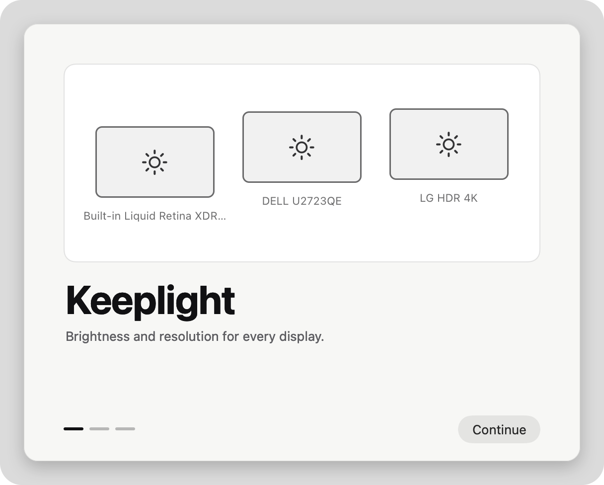</picture></td>
    <td width="33%"><picture><source media="(prefers-color-scheme: dark)" srcset="docs/images/app/onboarding-2-dark.png">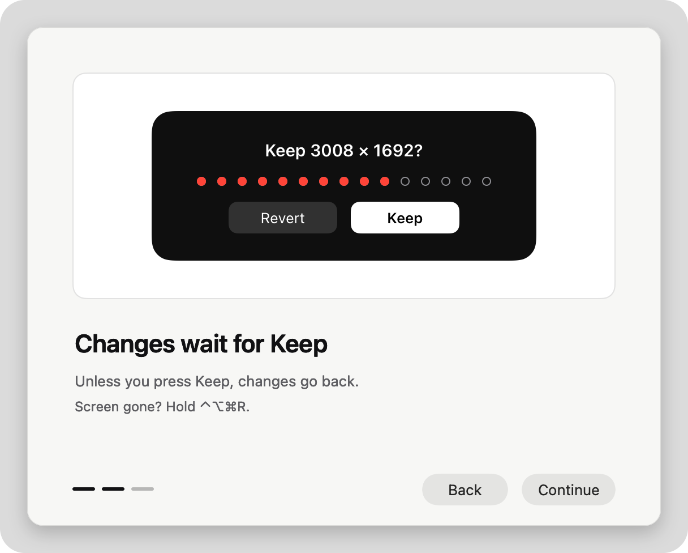</picture></td>
    <td width="33%"><picture><source media="(prefers-color-scheme: dark)" srcset="docs/images/app/onboarding-3-dark.png">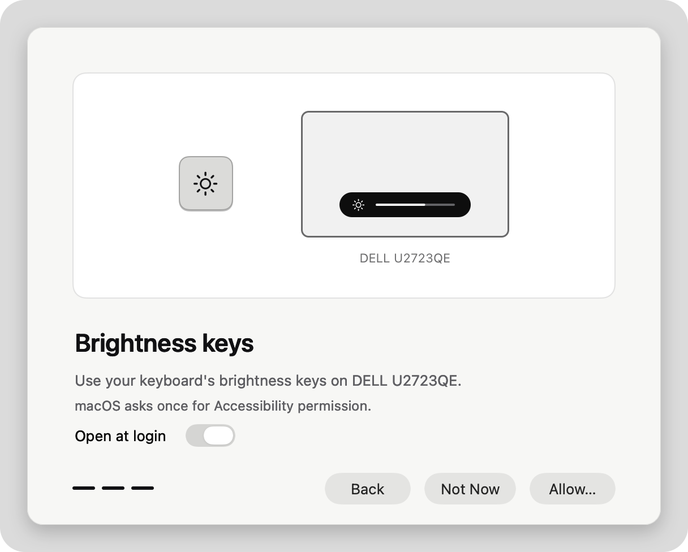</picture></td>
  </tr>
</table>

### Settings

`General` holds Open at login, the menu bar item, the revert time, brightness after wake and the
brightness keys; `Displays` names each display, says how its brightness works (`DDC/CI`, `macOS`, or
why not) and copies a report; `About` measures what the app is doing right now.

<table>
  <tr>
    <td width="33%"><picture><source media="(prefers-color-scheme: dark)" srcset="docs/images/app/settings-general-dark.png">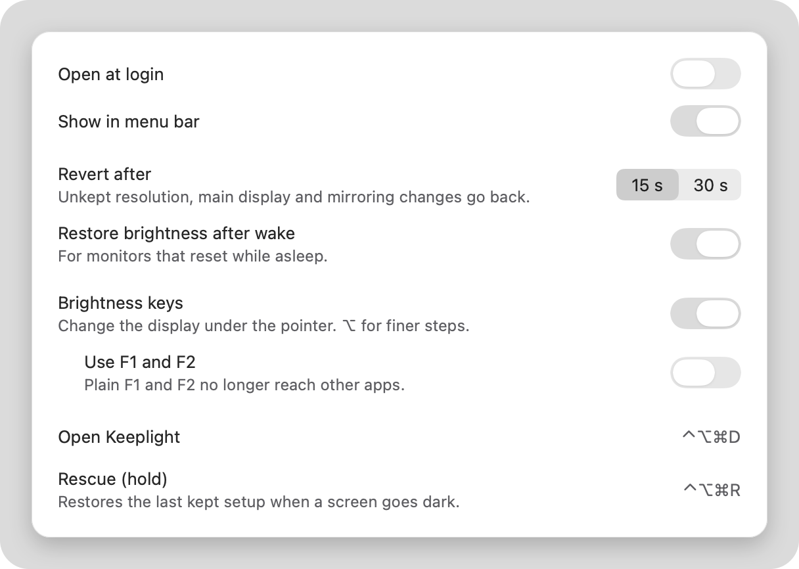</picture></td>
    <td width="33%"><picture><source media="(prefers-color-scheme: dark)" srcset="docs/images/app/settings-displays-dark.png">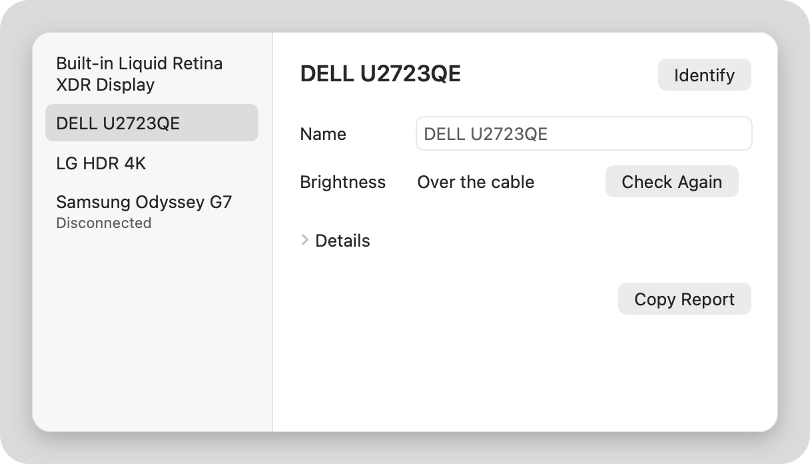</picture></td>
    <td width="33%"><picture><source media="(prefers-color-scheme: dark)" srcset="docs/images/app/settings-about-dark.png">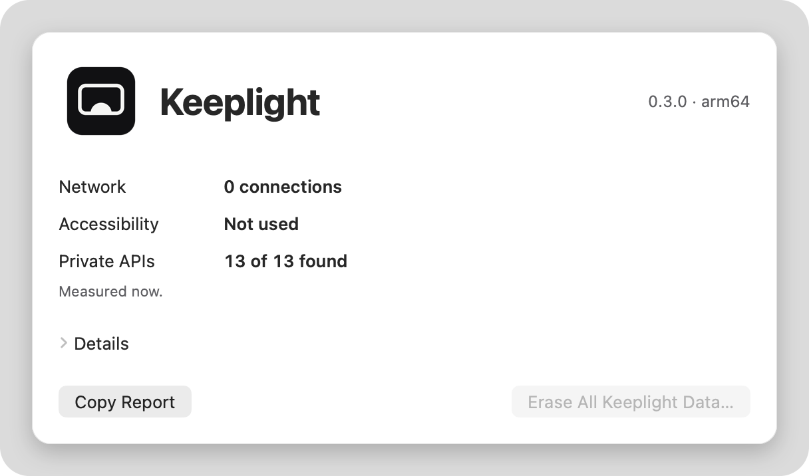</picture></td>
  </tr>
</table>

## Permissions and privacy

- **One permission, and only if you want it.** Accessibility is needed only for the brightness keys,
  and macOS asks for it only when you turn them on, never by itself at launch. Everything else, DDC/CI
  included, needs no permission. If the permission goes away, Settings says so and offers
  `Allow in System Settings…`.
- **No network.** Keeplight contains no networking code: `scripts/audit-network.sh` fails the build
  if either binary imports a socket, URL-loading or Network.framework symbol, or links a networking
  framework. It never checks for updates. Settings › About counts the app's open internet sockets when
  you open the tab (`0 connections`).
- **Undocumented macOS interfaces, in the open.** Unlike most utilities, Keeplight says exactly which
  private functions it calls. Each one is resolved at run time with `dlsym`; a missing one turns off
  its feature instead of crashing.

  | Where | Functions | What for |
  |---|---|---|
  | CoreGraphics (SkyLight as fallback) | `CGSGetNumberOfDisplayModes`, `CGSGetDisplayModeDescriptionOfLength`, `CGSGetCurrentDisplayMode`, `CGSConfigureDisplayMode`, `CGSConfigureDisplayEnabled` | every display mode, HiDPI included; setting one; software disconnect and reconnect |
  | DisplayServices (private framework) | `DisplayServicesGetBrightness`, `DisplayServicesSetBrightness`, `DisplayServicesCanChangeBrightness` | brightness of built-in and Apple displays |
  | CoreDisplay | `CoreDisplay_DisplayCreateInfoDictionary` | display names and locations |
  | IOKit | `IOAVServiceCreateWithService`, `IOAVServiceReadI2C`, `IOAVServiceWriteI2C`, `IOAVServiceCopyEDID` | DDC/CI and EDID over the display cable (Apple silicon) |

  Dimming below the minimum uses the public CoreGraphics gamma-table API. There is no kernel extension,
  no privileged helper, no entitlement, and nothing that touches System Integrity Protection.
- **What it changes.** Only what you ask for: display modes and arrangement, DDC/CI values on your
  monitors, and the gamma table of a monitor dimmed below its minimum (put back at 100 %, when
  Keeplight quits, on Rescue and on Erase). `Open at login` registers Keeplight as a login item.
- **What it keeps.** Its preferences and `~/Library/Application Support/Keeplight` (the change journal,
  a pending change, the last setup you kept, displays it disconnected, mirrors it started). Settings ›
  About › `Erase All Keeplight Data…` removes all of it.

## FAQ

**Why do the brightness keys need Accessibility?** macOS sends the brightness keys to itself; an app
that wants to act on them has to watch the keyboard with an event tap, and macOS allows that only with
the Accessibility permission. Keeplight's tap looks at the brightness keys (and F1/F2 if you turn that
on) and lets every other key through untouched and unread. It keeps a key press only when it changed a
DDC monitor with it; built-in and Apple displays keep macOS's own handling.

**Why can't Keeplight change my monitor's brightness?** The panel then shows `No brightness control`;
its ⓘ gives the reason. The usual ones: DDC/CI is turned off in the monitor's own menu; many docks
and some adapters block it, and DisplayLink and other USB or virtual displays, AirPlay and Sidecar
have no DDC path at all; the monitor locks brightness on some inputs or picture modes (HDR, eco); or
the Mac is an Intel Mac, where Keeplight has no DDC/CI yet. `Check Again` asks the monitor again, and `keeplight doctor <display>`
shows each step it tried.

**What does "below the minimum" actually do?** Above about 19 the slider is the monitor's own
brightness, sent over DDC/CI. Below it the monitor stays at its lowest backlight and Keeplight scales
the display's gamma table down, to black at 0. The picture gets darker, the backlight does not: it
saves no extra power, and contrast drops on the way down. The table goes back when you raise the
slider, when Keeplight quits, on Rescue and on Erase; after wake a black monitor comes back at the
first step, so a sleeping Mac never wakes to a screen that looks dead. On a Mac screen 0 turns the
backlight off, exactly as macOS does. The CLI's `brightness` command uses only the monitor's own range.

**A resolution change left me with a blank screen.** Wait: it goes back by itself after 15 seconds
(30 if you chose that). If a screen stays wrong, hold <kbd>⌃⌥⌘R</kbd>, or run `keeplight rescue` in
Terminal. Holding <kbd>⇧</kbd> while Keeplight starts skips everything it would apply at launch.

**Is it risky that it uses private interfaces?** Display utilities generally rely on them: macOS has
no public way to disconnect a display or to speak DDC/CI on Apple silicon. Keeplight never assumes they
exist: each is looked up at run time, a missing one turns off only its feature, and
`keeplight interfaces` shows what was found on your Mac. A macOS update can still change how one
behaves; that is why risky changes wait for Keep and Rescue is one chord away.

**Does it work on Intel Macs?** Yes, the app is universal: resolution, arrangement and Apple-display
brightness work. External brightness over DDC/CI, and dimming below the minimum, need Apple silicon.

**The brightness keys stopped working after an update.** Releases are signed with the same Developer
ID, so macOS keeps the permission. A locally built, ad-hoc signed app loses it on every build: remove
Keeplight in System Settings › Privacy & Security › Accessibility with **−** and turn the keys on again.

**I used Dotpitch.** Keeplight was called Dotpitch until 0.2. On its first launch it takes over
Dotpitch's saved state once (a pending revert, disconnected displays, history, names); the brightness
keys and their permission start fresh.

**Does it send anything anywhere?** No. There is no networking code in it.

### Known limits

- Hardware behaviour (DDC timing per monitor, wake, hot-plug, the Accessibility prompt) is tested with
  fakes in `swift test`, not with every monitor; `keeplight doctor --markdown` makes a report for an
  issue, with the serial number shortened to its last 3 characters.
- A software disconnect lasts until you log out.

## Command line

```sh
keeplight list
keeplight info main
keeplight modes main               # --all for every raw mode
keeplight mode main 2560x1440@60 hidpi
keeplight main "DELL U2723QE"
keeplight mirror 1 0 && keeplight unmirror 1
keeplight brightness main 70       # the monitor's own 0–100
keeplight ddc main get volume
keeplight ddc main set input 0x0f
keeplight edid main --json
keeplight doctor main              # --markdown for a GitHub issue (serial shortened)
keeplight journal --since 1h
keeplight rescue --dry-run
keeplight interfaces               # private macOS functions and their status on this Mac
```

A display is a list index, `id:<displayID>`, `main`, `builtin` or part of its name. Changes made from
the command line apply at once, without a Keep card, and go into the same journal as the app's.
`disable` refuses to turn off the last active physical display. `keeplight help <command>` explains
each command.

## Build and test

```sh
swift build
swift test
scripts/bundle-app.sh                # dist/Keeplight.app + dist/keeplight; ad-hoc unless SIGN_IDENTITY is set
UNIVERSAL=1 scripts/bundle-app.sh    # arm64 + x86_64
scripts/check-bundle.sh              # the bundle: app and CLI present, no render tool, no debug hooks
scripts/audit-network.sh             # no networking symbols or frameworks in the release binaries
scripts/copy-budget.sh               # the app's copy stays within 560 words
scripts/render.sh                    # every surface offscreen → .build/render/*.png (debug tool, never bundled)
scripts/release.sh                   # maintainers: universal, Developer ID, notarized Keeplight.dmg
```

`bundle-app.sh` assembles and verifies the bundle in `.build/bundle/` and only then replaces `dist/`;
a failed run leaves `dist/` as it was. None of the checks launch the app or touch a display.

The README images are generated: `swift tools/readme/render-logo.swift` (logo),
`python3 -I tools/readme/hero.py` (the animated hero), and `scripts/render.sh && swift
tools/readme/frame-screenshots.swift` (screenshots and the Keep card GIF).

Specification in [docs/SPEC.md](docs/SPEC.md), design in [docs/design/v4-keeplight.md](docs/design/v4-keeplight.md)
and [docs/design/v5-panel.md](docs/design/v5-panel.md). Keeplight is an independent implementation:
no code, assets or text from any other product are included.

## License

[MIT](LICENSE) © 2026 Hasan Taha Ozlu
